# 머문자리

**머문자리**는 차박지를 고르고, 차 안에 잠자리를 마련하고, 그날 밤의 차량 기록을 후기로 남기는 **Pleos Connect 차량용 앱**입니다.

“내 차로 이곳까지 들어갈 수 있을까? 밤새 난방을 쓰면 아침에 배터리가 얼마나 남을까?” 첫 겨울 차박을 준비하는 운전자는 먼저 다녀간 차의 기록을 살펴보고, 내 차의 잔량과 기상 시각을 기준으로 머물 곳을 고릅니다. 도착하면 앞유리로 일출을 볼 방향에 차를 세우고, 그곳을 잘 아는 운전자의 세팅을 불러올 수 있습니다.

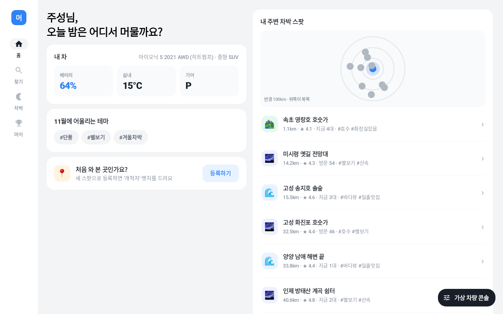

## 화면으로 보는 하룻밤

아래는 일반 Android 기기에서도 실행할 수 있는 `mockDebug` 화면입니다. 차량 신호와 날씨, 이전 방문 기록은 시연용 데이터입니다.

| 내 차가 들어갈 수 있는 곳 찾기 | 출발 전에 도착·기상 잔량 확인하기 |
| --- | --- |
| 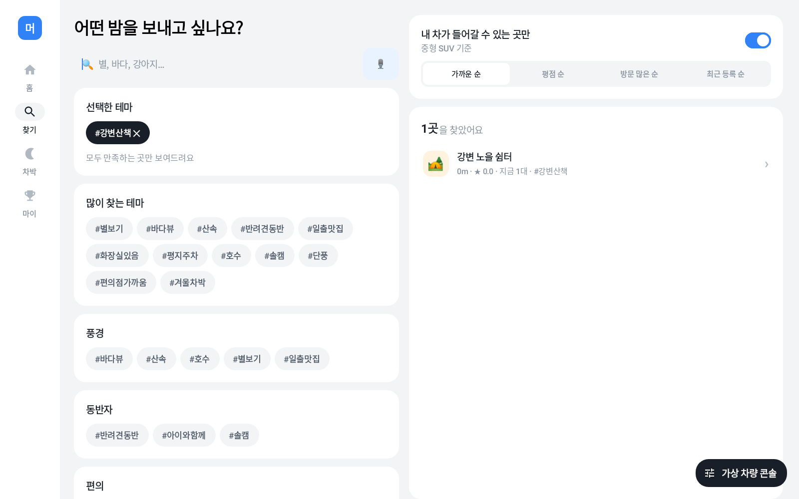 | 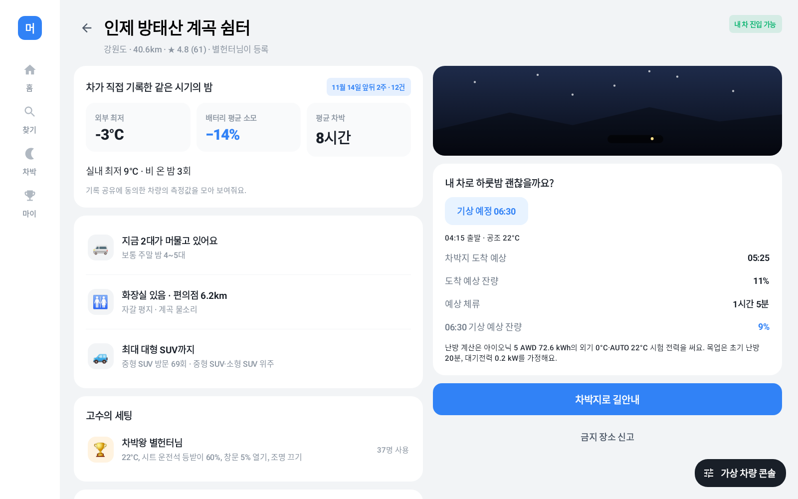 |
| `#반려견동반` 같은 테마를 고르고 **내 차가 들어갈 수 있는 곳만** 켜면, 등록된 진입 가능 차급에 맞는 장소가 남습니다. | 방태산 예시에서는 **04:15 출발 25% → 05:25 도착 11% → 06:30 기상 9%**입니다. 왼쪽은 이 시기 방문 차량의 기록이고, 오른쪽은 내 차의 예상 잔량입니다. |

난방을 켠 밤의 잔량은 2021 아이오닉 5 AWD 72.6 kWh 히트펌프 모델의 **외기 0°C·AUTO 22°C** 공개 시험값으로 추정합니다. 초기 난방 시간과 대기전력은 목업 가정입니다. 송지호처럼 조건에 맞는 자료가 부족한 곳은 도착 잔량까지만 계산하고 기상 잔량에는 **예측 자료 부족**을 표시합니다. [자료가 부족한 화면](docs/images/departure-direct/missing.png) · [난방 전력과 계산 근거](docs/hvac-power-research.md)

| 차박지까지 주행하기 | 일출을 볼 방향으로 주차하기 |
| --- | --- |
| 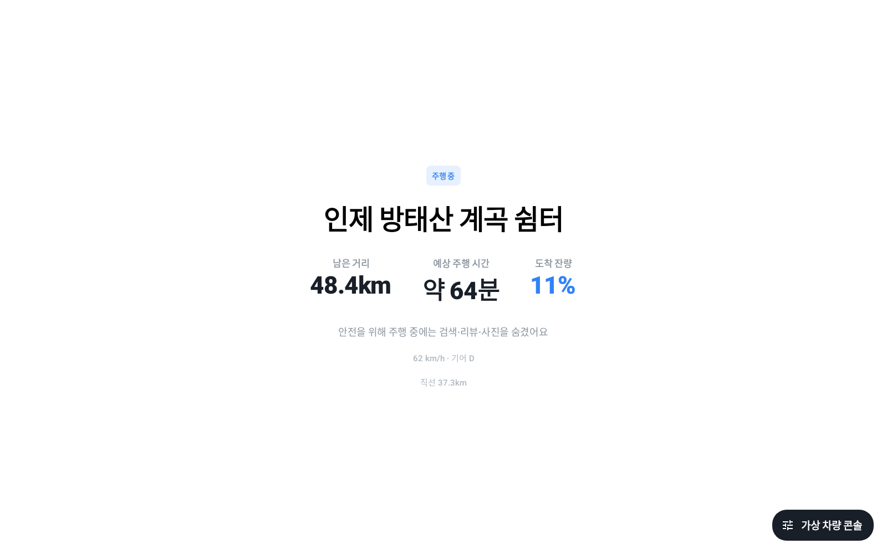 | 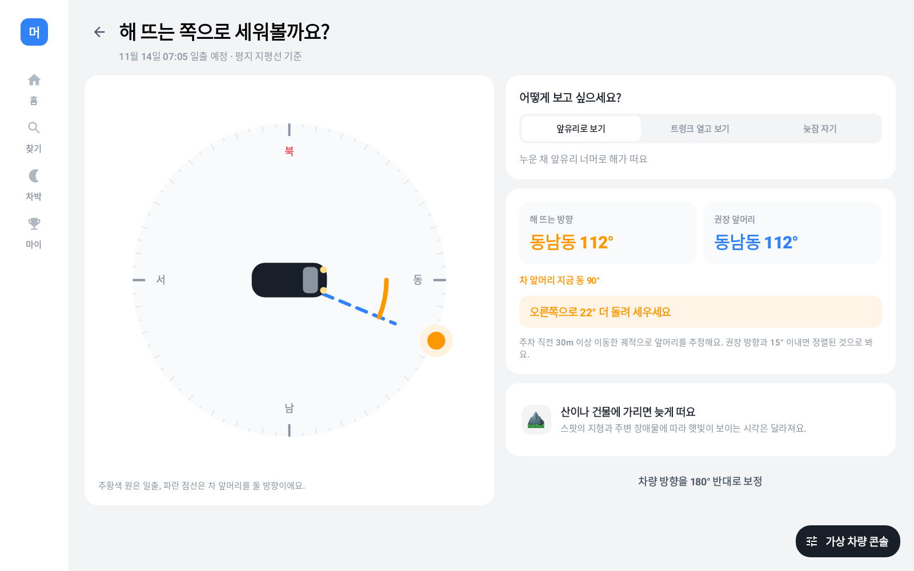 |
| **차박지로 길안내**를 누르면 선택한 스팟을 목적지로 삼습니다. 주행 중에는 남은 거리와 예상 주행 시간, 도착 잔량이 크게 보입니다. | 스팟에 도착하면 앞유리로 해를 볼지, 트렁크 쪽으로 볼지 고릅니다. 앱이 위치와 날짜로 일출 시각과 방위를 계산해 **차 앞머리를 둘 방향**을 알려줍니다. |

| 먼저 다녀간 사람의 세팅 불러오기 | 차박 중 온도와 배터리 살펴보기 |
| --- | --- |
| 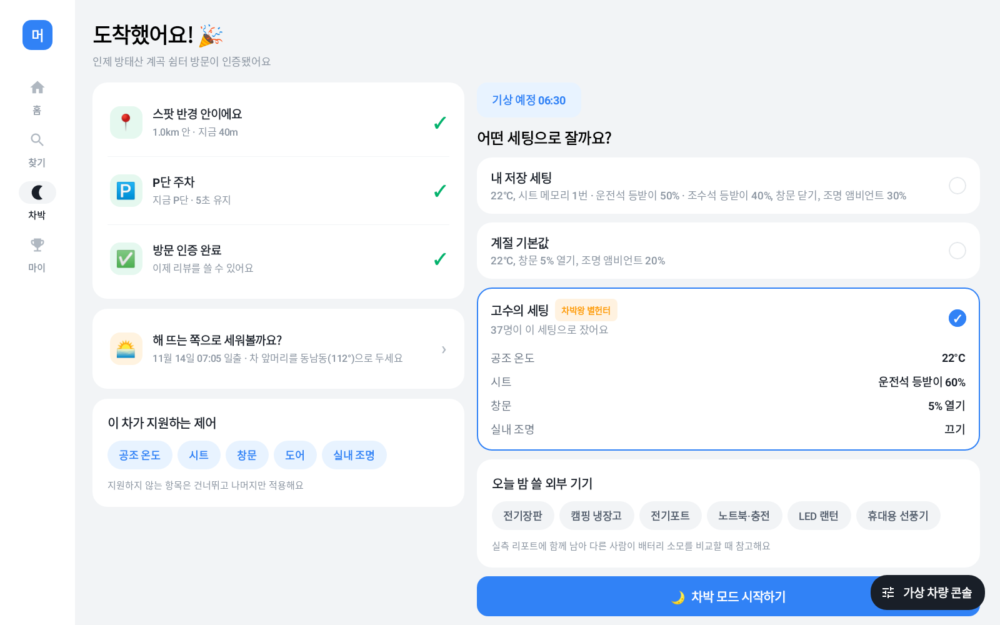 | 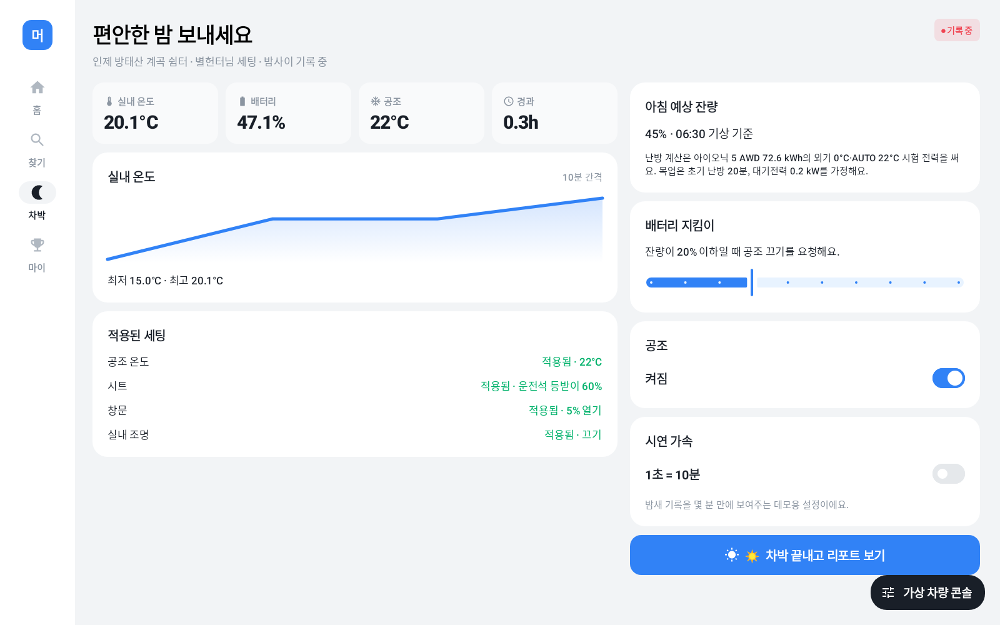 |
| 도착 인증 후 **고수의 세팅**을 고르면 공조 온도, 좌석별 등받이, 창문, 조명 중 내 차가 지원하는 항목을 적용합니다. 개인 시트 메모리 번호는 공유하지 않습니다. [내 좌석별 세팅 화면](docs/images/readme/my-settings.png) | 차박 모드에서 실내 온도 변화와 항목별 적용 결과를 확인합니다. 배터리가 설정한 보호 기준에 닿으면 주차 중인 차에 공조 끄기를 요청합니다. |

| 밤사이 기록 돌아보기 | 방문과 기여 기록 모아 보기 |
| --- | --- |
| 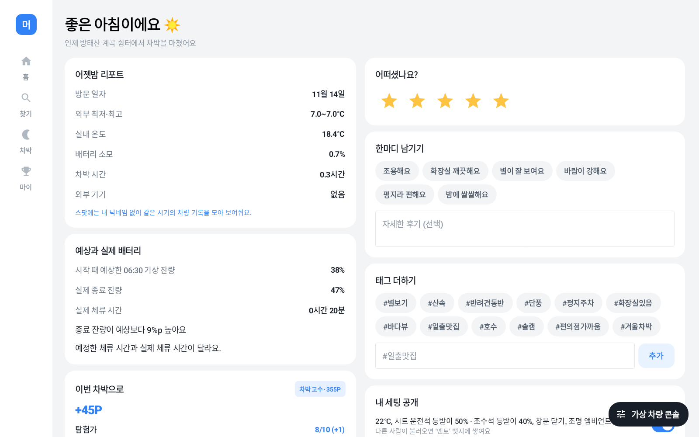 | 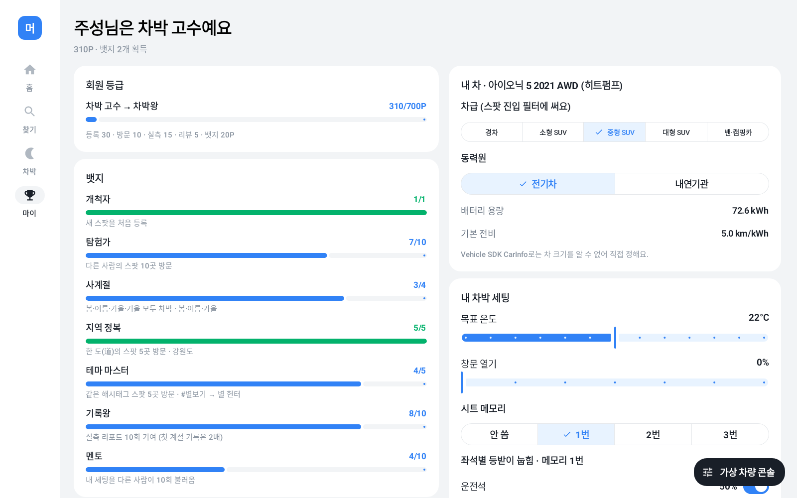 |
| 기록에 동의하고 측정값이 충분히 쌓이면 **어젯밤 리포트**가 생깁니다. 위 출발 예시와 별도로 진행한 이 시연은 약 20분 만에 마쳤습니다. 앱은 **기상 예상 38%**와 **종료 잔량 47%** 옆에 예정한 체류 시간과 실제 체류 시간이 다르다고 표시합니다. | 별점·후기·해시태그는 방문 인증 리뷰로 남깁니다. 차량 측정값은 스팟에 익명 통계로만 표시합니다. **마이**에서는 스팟 방문, 새 장소 등록, 리포트 작성으로 쌓인 뱃지와 등급을 확인합니다. |

**휴대폰으로 사진과 상세 후기 작성하기** · 차박 종료 후 기어가 P일 때, 리뷰의 별점 아래에서 **사진·상세 후기 QR 보기**를 누르세요. [차량 화면](docs/images/readme/mobile-review-qr.png)의 QR을 휴대폰 카메라로 찍으면 [상세 후기 폼](https://meomunjari-review.startview.chatgpt.site/)이 열립니다. 사진을 최대 5장 고르고 별점과 글을 미리 볼 수 있습니다. 사진과 글은 서버로 보내지 않으며 새로고침하면 사라집니다. 방문 인증 리뷰는 차량 화면에서 등록합니다.

## 새 스팟 등록해 보기

**홈 → 왼쪽 아래 ‘처음 와 본 곳인가요?’ → 등록하기**에서 현재 위치를 스팟으로 등록합니다. `mockDebug`의 **테스트 위치 선택**으로 아래 두 경우를 직접 비교할 수 있습니다. Pleos 빌드는 차량의 현재 좌표를 사용합니다.

| 고성 봉포 공터 · 등록 가능 | 경기 광주 상수원보호구역 · 등록 차단 |
| --- | --- |
| 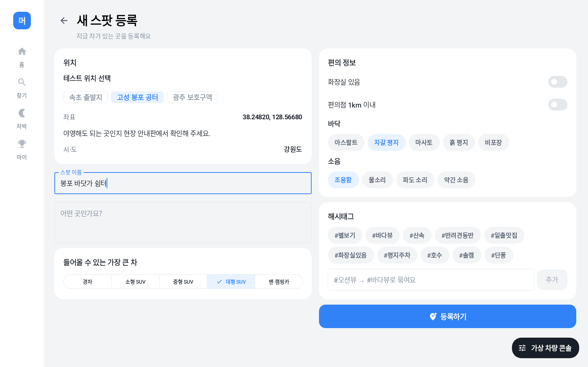 | 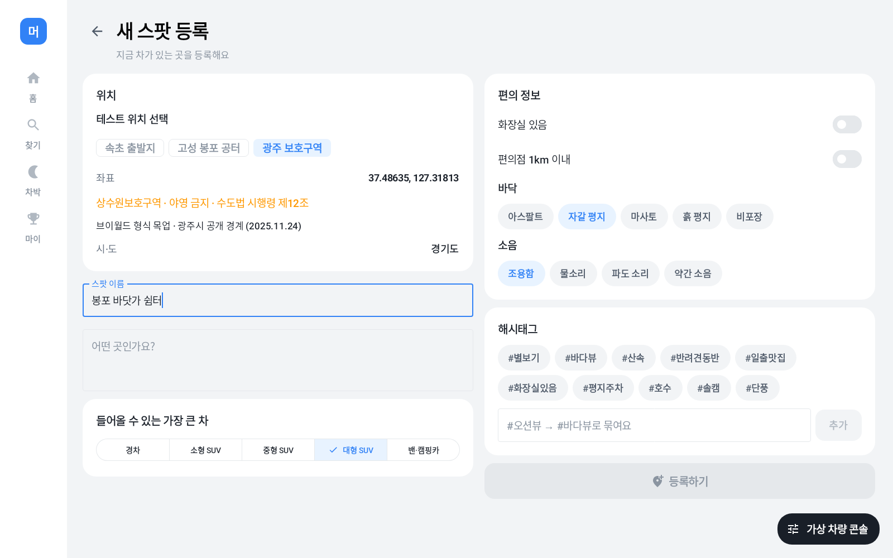 |
| 위도 `38.2482`, 경도 `128.5668`. 주차 후 이름을 입력하면 새 장소를 등록할 수 있습니다. 야영 가능 여부는 **확인 필요**로 표시합니다. | 위도 `37.48634563`, 경도 `127.31812732`. 좌표가 동봉한 광주시 상수원보호구역 경계 안에 있어 등록을 막습니다. [경계 데이터 출처와 판정 방법](docs/restricted-zones-v1.md) |

## 직접 시연하기

1. Android Studio에서 저장소를 열고 Android SDK Platform 37을 설치합니다. **Build Variants → `mockDebug`**를 선택해 Android 9(API 28) 이상 기기나 에뮬레이터에서 가로 화면으로 실행합니다. 앱 이름은 **머문자리 (mock)**입니다.
2. **찾기 → 인제 방태산 계곡 쉼터**를 엽니다. 오른쪽 아래 **가상 차량 콘솔**에서 배터리를 `25%`로 바꾸고, 스팟 상세에서 기상 시각을 `06:30`으로 정합니다. 출발 시각에 따라 체류 시간과 추정 잔량이 달라집니다.
3. **차박지로 길안내 → 확인**을 누른 뒤 가상 차량 콘솔에서 **목적지까지 자동 주행**을 시작합니다. 스팟 반경 안에 도착해 기어를 **P**에 두고 5초가 지나면 방문이 인증됩니다.
4. 도착 화면에서 **해 뜨는 쪽으로 세워볼까요?**를 열어 주차 방향을 확인합니다. 뒤로 돌아와 고수의 세팅을 고르고 **차박 모드 시작하기**를 누릅니다. 기록 동의 창이 뜨면 **동의하고 기록**을 선택합니다. 차박 도중 **마이 → 차박 중 차량 기록 공유**를 끄면 이번 밤의 기록이 지워집니다. 다시 켜면 다음 차박부터 기록합니다.
5. 차박 중 **시연 가속**을 켜면 1초가 차박 시간 10분으로 흐릅니다. 온도 기록이 쌓이면 **차박 끝내고 리포트 보기**를 눌러 리포트를 확인하고 리뷰를 작성합니다.

## 실행 환경과 자료

| 빌드 | 실행 환경과 데이터 |
| --- | --- |
| `mockDebug` | 일반 Android 기기. 앱 안의 가상 차량 콘솔에서 위치·기어·배터리 등을 조작합니다. |
| `pleosDebug` | Pleos Connect 에뮬레이터용. Vehicle SDK로 차량 상태와 제어를, FusedLocation과 NaviHelper로 현재 위치와 목적지 설정을 연결합니다. 차량이 지원하는 제어 범위를 따릅니다. |

두 빌드 모두 별도 서버 없이 동작합니다. 스팟·날씨·보호구역은 앱에 담긴 예시 데이터를 사용하며, 시연 중 새로 작성한 스팟·리포트·리뷰는 앱 프로세스를 종료하면 초기화됩니다.

```sh
./gradlew :app:installMockDebug
./gradlew :app:testMockDebugUnitTest :app:testPleosDebugUnitTest :app:assembleMockDebug :app:assemblePleosDebug
```

Kotlin과 Jetpack Compose를 사용합니다. 공통 화면과 계산 로직은 [main](app/src/main/java/com/example/meomunjari), 가상 차량과 Pleos SDK 연결 코드는 각각 [mock](app/src/mock)과 [pleos](app/src/pleos)에 있습니다. 최초 빌드에는 Gradle 및 의존성 저장소 접근이 필요합니다.

[기획 초안](docs/application-v1.md) · [버전별 기획 자료](docs/) · [v1 → v2 변경표](docs/changes-v1-v2.md) · [시간대별 날씨 목업 편집](docs/hourly-weather-v2.5.md)
