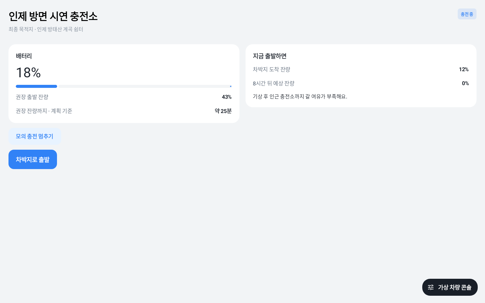

# v2.3 충전소 경유 화면

| 항목 | v2.2 | v2.3 |
| --- | --- | --- |
| 경유지 도착 | 목업이 추천 충전량을 즉시 가산하고 자동 주행을 계속한다. | 충전소에서 정차해 P단으로 전환하고, 충전 대기 화면을 연다. |
| 충전 중 | 주행 화면에 추천 시간만 표시한다. | 현재 잔량, 권장 출발 잔량, 목표까지의 계획상 충전 시간, 지금 출발할 경우의 차박지 도착·기상 예상 잔량을 표시한다. |
| 다음 주행 | 충전 과정을 한 틱에 마친다. | 목표 도달을 안내하고 사용자 선택으로 차박지까지 주행한다. 일시정지와 중간 출발도 가능하다. |

## mock 시연

1. 11월 목업에서 속초 출발, 인제 방태산 계곡 쉼터, 출발 잔량 25%를 선택한다. 스팟 상세에서 충전소 경유를 선택한다.
2. 가상 차량 콘솔에서 자동 주행을 켜고 콘솔을 닫는다. 충전소에 도착하면 최종 목적지를 유지하고 **충전 대기**를 표시한다.
3. **모의 충전 시작**을 누른다. 콘솔에서 **1초=1분**을 선택하면 목업 잔량이 초당 약 1%p 증가한다. 콘솔의 **모의 충전** 스위치로도 시작·일시정지할 수 있다.
4. 목표에 도달하거나 일찍 출발하려면 **차박지로 출발**을 선택한다. 현재 잔량으로 최종 목적지까지 주행한다.

## 차량 연동

앱이 열려 있을 때 첫 경유지 도착 이벤트와 P단·정차 상태로 화면을 연다. 순정 내비의 차박지 안내를 유지한다. 차량에서 충전 상태를 읽을 수 없으면 **충전 상태 확인 불가**로 표시한다. Pleos 화면의 버튼은 앱의 안내 화면으로 복귀하는 동작이다. 충전기 출력, 충전 곡선, 차량별 충전 제어는 이번 시연 범위에 포함하지 않는다.

충전 상태는 Android Automotive의 EV_CHARGE_STATE와 CAR_ENERGY 읽기 권한을 사용한다. 표시하는 남은 시간은 앱이 정한 출발 목표와 목업 속도(1%p/분)를 사용한 추정치다. [Android 차량 속성](https://developer.android.com/reference/android/car/VehiclePropertyIds#EV_CHARGE_STATE)

## 검증

mock·Pleos 디버그 APK를 빌드했다. 단위 테스트는 mock 29건, Pleos 25건이 통과했다. 충전 대기 중 잔량 유지, 충전·일시정지, 목표 도달, 중간 출발, 취소, 중복 경유지 도착 이벤트, 최종 목적지 유지를 확인했다. 별도 Robolectric 화면 테스트 2건에서 충전 화면 버튼을 통한 시작·일시정지·재개·출발 흐름과 기존 차박 종료 화면을 확인했다. 실제 차량의 충전 상태 수신과 순정 내비 지도 표시는 실기 확인이 남아 있다.
