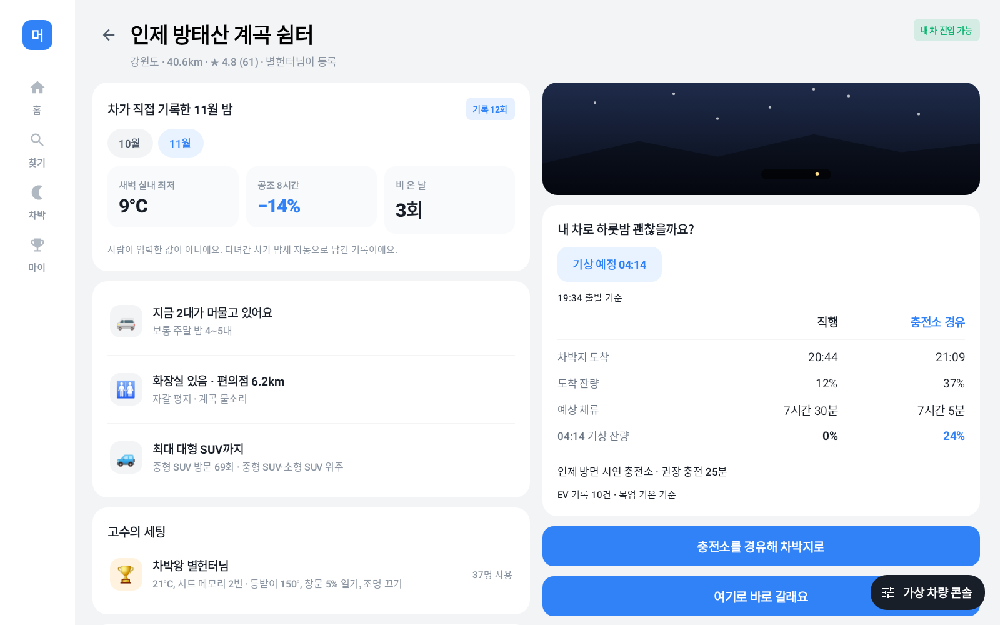

# v2.4 출발 전 직행·충전소 경유 비교

| 항목 | v2.3 | v2.4 |
| --- | --- | --- |
| 스팟 상세 | 직행 예상 잔량과 권장 충전 시간 표시 | 같은 출발 시각에 대해 직행과 충전 경유의 차박지 도착 시각, 도착 잔량, 기상 예상 잔량을 나란히 표시 |
| 기상 시각 지정 | 직행 예상 도착에서 기상까지 체류 시간 계산 | 두 경로에 같은 날짜의 기상 시각을 적용하고 체류 시간도 비교. 경유가 기상보다 늦으면 ‘기상 후 도착’ 표시 |
| 기상 시각 미지정 | 도착 후 8시간 | 두 경로 각각 도착 후 8시간 기준 |
| 경유 선택 | 충전이 필요한 경우에 제안 | 필요하면 권장 충전 시간, 직행이 충분하면 선택 충전 15분으로 비교. 만충까지 15분 미만이면 해당 시간으로 단축 |

도착 시각은 목업 도로 거리와 평균 주행 속도 45km/h로 추정한다. 경유에는 양쪽 주행 구간과 정차 충전 시간을 포함한다. 충전소까지 이동한 뒤의 잔량에 계획한 충전량을 더하고(분당 1%p, 최대 100%), 남은 주행과 체류 중의 예상 소모를 순서대로 뺀다. 충전소 대기열과 실시간 교통은 반영하지 않는다.

도달 가능한 경유지가 없으면 경유 열에 대시를 표시한다. 출발 잔량으로 직행이 어려우면 해당 칸에 ‘도달 어려움’, 도착 월의 유효한 EV 기록이 두 건 미만이면 기상 잔량에 ‘측정중’을 표시한다.

## 검증

mock 단위 테스트 32건, Pleos 단위 테스트 28건과 별도 Robolectric 화면 테스트 2건을 통과했다. 25% 출발 시나리오의 캡처에서 04:14 기상 기준 직행은 20:44 도착·기상 잔량 0%, 25분 충전 경유는 21:09 도착·기상 잔량 24%로 표시됐다. 기상 시각 변경, 충전 선택이 필요한 경우와 선택 충전, 자정 경계, 기상 이후 도착, 예측 자료 부족, 경유 불가, 경유 선택 후 충전 화면 진입을 검증했다.
